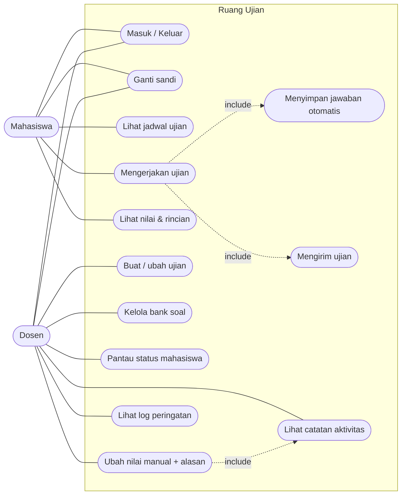

# Use Case Diagram — Ruang Ujian

Dua aktor: **Mahasiswa** dan **Dosen**. Peran ditentukan server berdasarkan akun.

## Ringkasan use case

| Kode | Use case | Aktor | Keterangan |
|------|----------|-------|------------|
| UC1  | Masuk / Keluar | Mahasiswa, Dosen | Autentikasi berbasis token sesi di cookie |
| UC2  | Ganti sandi | Mahasiswa, Dosen | Perlu sandi lama |
| UC3  | Lihat jadwal ujian | Mahasiswa | Jadwal yang dipublikasikan |
| UC4  | Mengerjakan ujian | Mahasiswa | Timer, navigasi soal, pilihan jawaban |
| UC5  | Simpan jawaban otomatis | Mahasiswa | Tiap pilihan langsung dikirim |
| UC6  | Mengirim ujian | Mahasiswa | Skor dihitung server |
| UC7  | Lihat nilai & rincian | Mahasiswa | Benar/salah per nomor |
| UC8  | Buat / ubah ujian | Dosen | Jadwal, durasi, publikasi |
| UC9  | Kelola bank soal | Dosen | Tambah/ubah/hapus soal, 4 pilihan 1 kunci |
| UC10 | Pantau status mahasiswa | Dosen | Belum mulai / berjalan / selesai |
| UC11 | Ubah nilai manual | Dosen | Wajib alasan, tercatat di audit |
| UC12 | Lihat log peringatan | Dosen | Tingkat rendah/sedang/tinggi |
| UC13 | Lihat catatan aktivitas | Dosen | Audit log aktivitas sistem |
